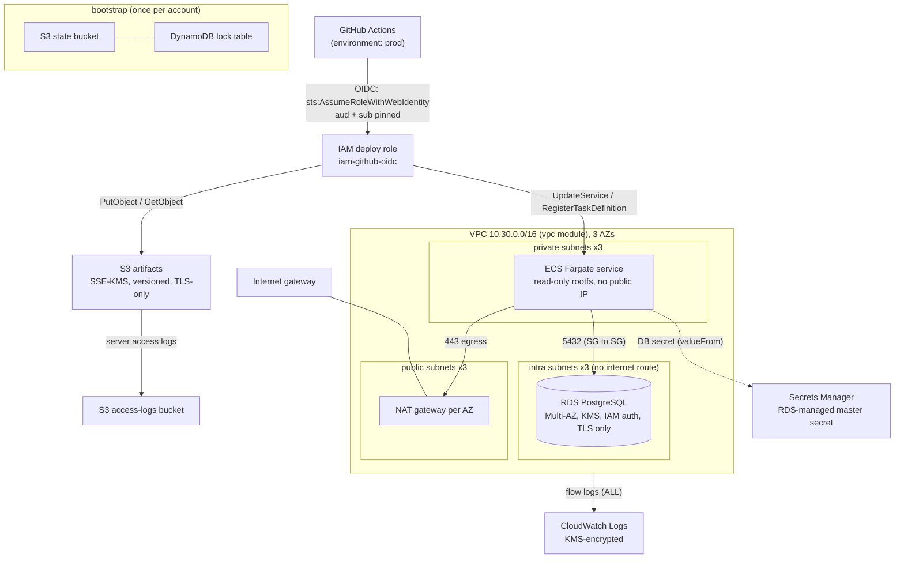

# terraform-aws-platform

[](https://github.com/ahmedelgmal310/terraform-aws-platform/actions/workflows/ci.yml)

Reusable Terraform modules for a small AWS application platform (network, container service, PostgreSQL, storage, CI identity), composed into `dev`, `staging` and `prod`, and checked on every push by unit tests, LocalStack apply tests, OPA policies on real plans, tflint and Checkov.

Nothing here has been applied to a real AWS account. The [last section](#what-runs-in-ci-and-what-needs-a-real-account) says exactly what is exercised where.

## Architecture

One environment (prod shown; dev and staging use a single NAT gateway):



## Repository layout

```
modules/            reusable modules, each with tests/unit, examples/complete and a README
  vpc/  s3-secure-bucket/  rds-postgres/  ecs-fargate/  iam-github-oidc/
live/{dev,staging,prod}/   environment roots: identical .tf files, different terraform.tfvars
bootstrap/          S3 + DynamoDB remote-state backend
policies/terraform/ OPA/Rego policies for `terraform show -json` plans, with *_test.rego
tests/policy-fixtures/insecure/   a plan the policies must reject (CI checks every expected violation)
scripts/            pinned tool installer, LocalStack start-up, plan summary, CI override writer
```

## Modules

| Module | What it creates | Notable defaults and guard rails | How it is tested in CI |
|---|---|---|---|
| [`vpc`](modules/vpc) | VPC, public/private/intra subnets per AZ, IGW, NAT (`none` / `single` / `per_az`), route tables, flow logs | Default SG stripped of rules; no auto-assigned public IPs; flow logs to a KMS-encrypted log group with a role scoped to that group; RFC 1918 CIDR and subnet-fit validation | 14 mocked unit tests; **applied on LocalStack** (42 resources) and read back through the EC2 and CloudWatch Logs APIs |
| [`s3-secure-bucket`](modules/s3-secure-bucket) | Bucket, public access block, ownership controls, versioning, SSE-KMS, lifecycle, policy, optional access logging, KMS key | All four public access block flags; ACLs disabled; policy denies non-TLS, TLS < 1.2 and non-KMS upload headers | 8 mocked unit tests; **applied on LocalStack** (log bucket + data bucket, 19 resources), policy read back through the S3 API |
| [`rds-postgres`](modules/rds-postgres) | DB instance, subnet group, parameter group, security group, KMS key, monitoring role | Encrypted with a CMK; RDS-managed master secret (no password in state); IAM auth; `rds.force_ssl`; never public; backups cannot be disabled; deletion protection and final snapshot by default | 11 mocked unit tests; planned in every environment. **Not applied** (RDS is not in LocalStack Community) |
| [`ecs-fargate`](modules/ecs-fargate) | Cluster, capacity providers, task definition, service, autoscaling, roles, security group, log group, KMS key | Read-only root FS, all capabilities dropped, no `:latest`, secrets only via `valueFrom`, no public IPs, scoped execution role, circuit breaker with rollback | 14 mocked unit tests; planned in every environment. **Not applied** (ECS is not in LocalStack Community) |
| [`iam-github-oidc`](modules/iam-github-oidc) | GitHub OIDC provider and a role with an inline policy | `aud` pinned, `sub` must name an org and repo (no `repo:org/*`), no `*` / `service:*` actions, no IAM user or access key creation, 1 h sessions | 12 mocked unit tests; **applied on LocalStack** (3 resources), trust policy and provider read back through the IAM API |

**Why ECS Fargate instead of EKS:** neither ECS nor EKS can be applied on LocalStack Community, so neither could be integration-tested here. ECS Fargate was chosen because it is the smaller control plane for a few services, has no per-cluster hourly fee, and is fully covered by mocked unit tests and environment plans. That limitation is the same as EKS would have had.

## How the environments differ

`live/dev`, `live/staging` and `live/prod` contain identical `.tf` files (a CI step diffs them) and differ only in `terraform.tfvars`:

| Setting | dev | staging | prod |
|---|---|---|---|
| VPC CIDR | 10.10.0.0/16 | 10.20.0.0/16 | 10.30.0.0/16 |
| NAT gateways | 1 (shared) | 1 (shared) | 3 (one per AZ) |
| Flow log retention | 30 days | 90 days | 365 days |
| RDS class / storage (max) | db.t4g.micro / 20 GiB (50) | db.t4g.small / 50 GiB (100) | db.r7g.large / 100 GiB (500) |
| RDS Multi-AZ | no | no | yes |
| Backup retention | 7 days | 14 days | 35 days |
| Deletion protection / final snapshot | off / skipped | on / taken | on / taken |
| Enhanced monitoring | off | 60 s | 15 s |
| Performance Insights retention | 7 days | 7 days | 93 days |
| ECS task size | 0.25 vCPU / 512 MiB | 0.5 vCPU / 1 GiB | 1 vCPU / 2 GiB |
| ECS tasks (min-max) | 1-2 | 2-4 | 3-10 |
| Capacity | FARGATE_SPOT + 1 on-demand base | FARGATE_SPOT + 1 on-demand base | FARGATE only |
| App log retention | 30 days | 90 days | 365 days |
| Resources in the CI plan | 82 | 84 | 88 |

The OPA sizing policy enforces these limits per environment (for example, a `db.r7g.large` in dev, Spot capacity in prod, or prod backups under 30 days all fail the plan).

## Remote state

`bootstrap/` creates a versioned, KMS-encrypted, TLS-only S3 bucket (`<project>-tfstate-<account id>`, via `s3-secure-bucket`) and a DynamoDB lock table with point-in-time recovery and KMS encryption. The bootstrap stack itself is applied on LocalStack in CI.

For a real account:

```sh
terraform -chdir=bootstrap init && terraform -chdir=bootstrap apply
terraform -chdir=bootstrap output -raw backend_config      # paste into live/<env>/backend.hcl
cp live/dev/backend.hcl.example live/dev/backend.hcl         # backend.hcl is git-ignored
terraform -chdir=live/dev init -backend-config=backend.hcl
terraform -chdir=live/dev plan -var 'allowed_account_ids=["111111111111"]'
```

The environment roots declare `backend "s3" {}` with partial configuration. The example uses `dynamodb_table` for locking; on Terraform 1.10+ `use_lockfile = true` (S3-native locking) can replace it. CI never touches a real backend: `scripts/localstack-override.sh` writes a git-ignored `*_override.tf` that switches the root to a local backend and points the provider at LocalStack.

## Security controls

| Control | Where it is implemented | Where it is enforced |
|---|---|---|
| No public S3 buckets, ACLs disabled | `s3-secure-bucket` | OPA `s3.rego`, Checkov, unit tests |
| Encryption at rest with rotating CMKs (S3, RDS, logs, DynamoDB) | every module creates its own key unless one is passed | OPA `encryption.rego`, Checkov, unit tests |
| TLS-only access to S3 (and TLS >= 1.2) and RDS (`rds.force_ssl`) | bucket policy, parameter group | OPA `s3.rego`, unit tests, LocalStack read-back |
| No SSH/RDP or any non-web port from the internet; no public RDS or tasks | security group rules, `publicly_accessible = false`, `assign_public_ip = false` | OPA `network.rego`, Checkov, unit tests |
| Least-privilege IAM, no wildcard actions, scoped `iam:PassRole` | module inline policies, `iam-github-oidc` validation | OPA `iam.rego`, Checkov, unit tests |
| Keyless CI: GitHub OIDC with pinned `aud` and `sub` | `iam-github-oidc` | input validation, OPA `iam.rego`, LocalStack read-back |
| No secrets in state or variables | RDS-managed master secret, ECS `valueFrom` | unit tests, Gitleaks on the full history |
| Required tags (`Project`, `Environment`, `Owner`, `ManagedBy`) | provider `default_tags` | OPA `tags.rego` |
| Per-environment size limits and resilience floors | `terraform.tfvars` | OPA `sizing.rego` |
| Supply chain: every action pinned to a commit SHA, every image by digest, every CLI by version + SHA-256, provider versions locked | `.github/workflows/ci.yml`, `scripts/install-tools.sh`, `.terraform.lock.hcl` | actionlint, Dependabot (Terraform + GitHub Actions) |

Checkov skips are listed with a reason in [`.checkov.yaml`](.checkov.yaml); one inline skip (`CKV_AWS_393` on the OIDC role) exists because Checkov cannot resolve list inputs passed through a module and reads the `sub` claim as `None`. That control is enforced on the resolved plan by `iam.rego` instead.

## CI

[`.github/workflows/ci.yml`](.github/workflows/ci.yml) runs on every push to `main` and on every pull request. Workflow permissions default to `contents: read`; only the two jobs that upload SARIF get `security-events: write`.

| Job | What it does |
|---|---|
| fmt / validate / docs / tflint | actionlint; `terraform fmt -check`; `init -backend=false` + `validate` in all 19 Terraform directories; environment drift guard; terraform-docs freshness check; tflint (`preset = "all"` + AWS ruleset 0.49.0) |
| unit tests (x5) | `terraform test` per module with `mock_provider "aws"` |
| policy unit tests | `opa fmt`, `opa check --strict`, `opa test` |
| checkov | Checkov 3.3.30 on the whole repository, SARIF to code scanning |
| gitleaks | Gitleaks 8.30.1 on the full git history, SARIF to code scanning |
| integration (x4) | starts LocalStack 4.14.0, runs `terraform test` against it (apply, assert, read back through the AWS API, destroy), then checks that no VPC, bucket, role or table is left behind |
| plan (x3) | plans each environment against LocalStack with `-refresh=false`, writes a plan summary to the job summary, runs Conftest on the plan JSON, uploads the plan as an artifact |
| policies reject an insecure plan | plans `tests/policy-fixtures/insecure` and fails unless Conftest rejects it with every violation listed in `expected-violations.txt` |
| ci-ok | single required status that is green only if every job above succeeded |

Tool versions: Terraform 1.17.0, AWS provider 6.68.0 (locked), tflint 0.64.0, terraform-docs 0.24.0, OPA 1.21.1, Conftest 0.71.1, Checkov 3.3.30, Gitleaks 8.30.1, actionlint 1.7.12, LocalStack 4.14.0.

Run locally (no Docker needed for the first set):

```sh
make tools          # pinned tflint, terraform-docs, opa, conftest into ./.bin
make fmt validate lint docs test-unit test-policy
# with LocalStack on localhost:4566:
make test-integration plan
```

## Results

From CI run [#40453425458](https://github.com/ahmedelgmal310/terraform-aws-platform/actions/runs/40453425458) on `main`:

| Check | Result |
|---|---|
| Module unit tests (mocked provider) | **59 passed, 0 failed** (vpc 14, ecs-fargate 14, iam-github-oidc 12, rds-postgres 11, s3-secure-bucket 8) |
| LocalStack integration tests | **9 runs passed, 0 failed** in 4 suites (vpc 2, s3-secure-bucket 3, iam-github-oidc 2, bootstrap 2); about 74 resources created and destroyed, nothing left behind |
| OPA policy unit tests | **64 / 64 passed** |
| Policies enforced on every environment plan | **40 deny rules** in 6 packages (s3 7, encryption 6, network 7, iam 8, tags 3, sizing 9); dev, staging and prod: 40 / 40 passed |
| Insecure fixture | rejected with 23 violations; all 15 expected violations present |
| Planned resources | dev 82, staging 84, prod 88 |
| Checkov | 272 passed, 0 failed, 4 skipped (the documented `CKV_AWS_393` inline skip, once per caller) |
| tflint, terraform fmt, validate (19 directories), terraform-docs, actionlint, Gitleaks | clean |

## Cost

[Infracost](https://www.infracost.io/) needs an API key (free, but it is a registered account), so it is not part of CI. The figures below are a hand estimate from AWS on-demand list prices for eu-west-1 at the time of writing. They cover always-on resources only and exclude data transfer, NAT data processing, log ingestion and S3 usage. Check them in the AWS Pricing Calculator before relying on them.

| Main cost drivers | dev | staging | prod |
|---|---|---|---|
| NAT gateways (hourly charge only) | 1, about $35/month | 1, about $35/month | 3, about $105/month |
| RDS instance | db.t4g.micro single-AZ, about $13/month | db.t4g.small single-AZ, about $26/month | db.r7g.large Multi-AZ, about $390/month |
| Fargate (ARM64) | 1 small Spot task, a few dollars | 2 Spot tasks, under $10 | 3 on-demand 1 vCPU / 2 GiB tasks, about $90/month |
| KMS keys | 5, $5/month | 5, $5/month | 5, $5/month |
| **Rough always-on total** | **about $60/month** | **about $80/month** | **about $600/month** |

The biggest levers are visible in the table: `nat_gateway_mode = "single"` and Spot capacity outside prod, and the prod database's Multi-AZ standby.

## What runs in CI and what needs a real account

| | Applied on LocalStack | Planned (LocalStack data sources, `-refresh=false`) + OPA | Unit-tested with mocked provider |
|---|---|---|---|
| vpc | yes | yes (in every env) | yes |
| s3-secure-bucket | yes | yes | yes |
| iam-github-oidc | yes | yes | yes |
| bootstrap (S3 + DynamoDB state backend) | yes | - | - |
| rds-postgres | **no**, RDS is not in LocalStack Community | yes | yes |
| ecs-fargate | **no**, ECS is not in LocalStack Community | yes | yes |
| live/dev, staging, prod as a whole | **no** (they contain RDS and ECS) | yes | - |

Things only a real AWS account can prove, and which this repository does **not** claim:

- That RDS and ECS resources create successfully and that the API accepts every argument combination (for example engine version and instance class availability in the region, Performance Insights retention, Fargate Spot capacity).
- That the IAM and KMS policies grant enough at runtime: LocalStack Community does not enforce IAM, bucket policies or KMS key policies, so the integration tests prove the documents are stored as written, not that they allow or deny the right calls.
- That the GitHub OIDC trust actually works end to end (a real token exchange with `token.actions.githubusercontent.com`).
- Real costs (see above) and real service quotas.
- The S3 remote backend with DynamoDB locking: CI uses a local backend for the environments; only the bootstrap stack that creates the backend resources is applied (on LocalStack).

## License

[MIT](LICENSE)
